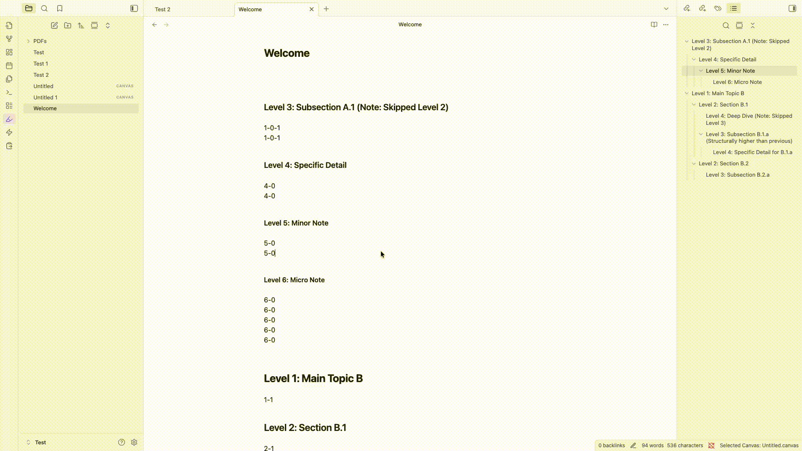
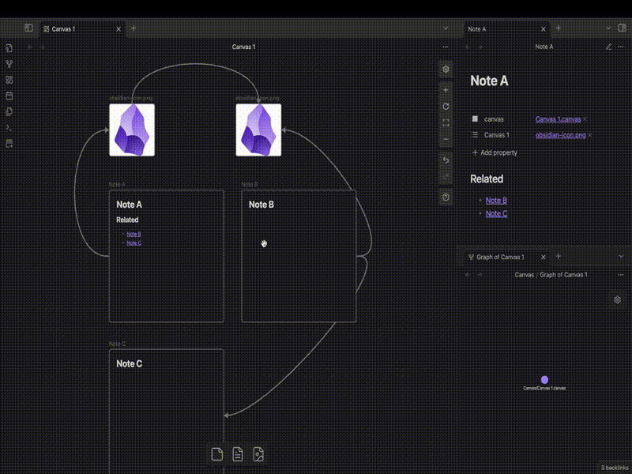

# Enhanced Canvas

> This Obsidian plugin enhances Obsidian Canvas with features I find essential.

## ✨New Feature✨

### Find in Canvas

Press **Cmd+F** (Ctrl+F on Windows), the core *Search current file* hotkey, in a Canvas, or run **"Find in canvas"** from the command palette, and type a word or a `[[link]]`. Every card that contains the word, or links to that note, is outlined and the rest are dimmed; matched text is highlighted and the view zooms to fit the results. Select text in a card and right-click → **Find in canvas** to search for it directly. Click an empty spot on the Canvas to clear.

-   While editing a card, Cmd/Ctrl+F still searches that card. Change the key via *Search current file* in Settings → Hotkeys, or bind *Find in canvas* separately.
-   Type several words to find cards with all of them, `OR` (uppercase) for either one, and `"quotes"` for an exact phrase: `canvas plugin OR "find text"`. Selected text is searched as one phrase.
-   Searches text cards, note cards (including their content), group labels, and web links.
-   Node colors and the `.canvas` file are never changed.
-   Change the highlight color with a CSS snippet: `body { --ec-find-color: <color>; }`
-   With *Search text in images* on, image cards whose text matches are found too, and the matching text is boxed on the image.

### Search Text in Images

Turn on *Search text in images* in settings, and the plugin reads the text in every image in your vault with the system's built-in OCR, on-device: the Vision framework on macOS, `Windows.Media.Ocr` on Windows 10/11. It also indexes the text in your PDFs (their embedded text only: scanned PDFs without a text layer, and password-protected PDFs, are not searchable). Then:

-   Run **"Search text in images"** (or click the ribbon icon) to search all images. It uses the same syntax as Find in canvas (words, `OR`, `"phrase"`). Results are numbered, sorted by the number of matching lines, and the total count is shown on top. They show the image with the matching text boxed and the notes that embed it; choose one to open that note at the image (a Canvas zooms to the image card). PDF results show the page number of each matching line; choose one to open the PDF at that page.
-   Run **"Rebuild image text index"** to read every image again, for example after an image couldn't be read. Images in *Settings → Files and links → Excluded files* are skipped.
-   **Find in canvas** also matches image cards by their text.
-   Turn on *Show image results in Search* to see matching images in core Search (search in all files) next to your notes, with the same query syntax as notes, and a thumbnail under each image's name. Add `-file:.md -file:.canvas` to the query to show only images and PDFs. The ribbon icon and command stay, for the boxed view.

The first run takes a few minutes for a large vault (about 0.3 s per image; a 2,700-page PDF takes about 11 s); after that only new or changed files are read. Large PDFs make the index big (tens of MB for a few hundred MB of PDFs); add folders you don't need searched to *Excluded files*. The index is stored in the plugin folder (the `ocr-index` folder), so no notes are added to your vault. A `"phrase"` can't span lines, so a PDF sentence that breaks at the end of a line isn't found as a phrase. On macOS the plugin runs the system's `osascript` to call the Vision framework; on Windows it runs the system's Windows PowerShell (`powershell.exe`) to call `Windows.Media.Ocr`. Nothing is downloaded and nothing leaves your computer. Off by default.

On Windows, OCR reads only the first language in *Settings → Time & language → Language* that has an OCR language pack installed (most languages install one with the language; if images can't be read, add the language's optical character recognition feature). Windows can't read HEIC or WebP images unless the matching codec from the Microsoft Store is installed.

Reading images needs a Mac or a Windows PC. On Linux, iPhone, iPad, or Android, turn on the same setting to search an index built on a computer and synced to the device (the `ocr-index` folder in the plugin folder). These devices don't read images themselves, and results show what that computer last read. Whether they can search depends on your sync tool syncing that `ocr-index` folder. Build the index on one computer only: two computers with this setting on overwrite each other's index.

### Split Node by Headings

**Split Node by Headings** instantly deconstructs a single node into a hierarchical tree based on its headings. You can try this by right-clicking on a file (text) node and selecting "Split by headings" in Canvas.

-   **Choose the heading level**: turn on *Choose heading level on split* in settings, and the plugin asks which level to split down to (e.g. H2). Deeper headings stay inside their parent card.
-   **Cards fit their content**: with *Auto-resize leaf nodes on split* on, each new card's height fits its text and the tree is re-laid out. *Max auto-resize height* caps how tall a card can grow; longer content scrolls.

### Add Notes by Tag

Right-click an empty spot on the Canvas and choose **"Add notes by tag..."** to add every note matching a tag query at once. Tags autocomplete as you type.

-   Space means AND: `#project #active`
-   `OR` means OR: `#book OR #article`
-   `-` excludes: `#project -#archived`

### Send Note to Canvas

With the **"Send to Canvas"** command, you can push your current markdown note directly to a specific Canvas. It automatically appends a "canvas" property to your note, allowing you to navigate back to the board instantly in the future.

Once you have sent a note, that Canvas becomes the "Selected." You can then use the **"Send to Selected Canvas"** command on other notes to instantly add them to the same board—bypassing the file selection step entirely.

### Auto-Resize Node

With this update, double-clicking the bottom edge engages **"Auto-Resize."** Now, when you drag the right edge to adjust the width or update the text, the height dynamically adjusts to fit your text. No need for repeated double-clicking!

Dragging the bottom edge to manually adjust the height disables the node's auto-resize feature.

## Main Feature

Based on this demo:

1. **Node addition**: When a note is added to the canvas, the plugin generates a 'canvas' property with a link to its corresponding canvas file.

2. **Edge addition**: Creating an edge in the Canvas generates a link to the target note within a property named after the canvas file (e.g., 'Canvas 1'), where the property name is derived from the canvas file name without its '.canvas' extension.

3. **Node Focusing**: Upon clicking a link to a .canvas file from a note, the system automatically focuses and zooms to the associated node in the canvas.

**Note 1**: All Canvas-related properties will be added when this plugin is enabled, and all properties added by this plugin will be removed upon disabling it.

**Note 2**: If you delete or rename a .canvas or Markdown file, all associated properties will also be updated.

**Note 3**: To stop the plugin from writing these properties, turn off *Enable Frontmatter Synchronization* in settings. Turning it off removes every property the plugin added.

### Hide Properties in Canvas Nodes

The properties panel inside Canvas nodes and embedded notes is hidden. To show it again, turn off *Enable Custom Visuals & CSS* in settings.

## Commands

-   **Adjust edges with shortest path**

    -   Adjusts edges between selected nodes using shortest path

-   **Delete edges between selected nodes**

    -   Removes all edges between selected nodes

-   **Add edges according the links in notes**

    -   Automatically creates edges between selected nodes based on links within notes

-   **Remove the property of all nodes in current Canvas**
    -   Removes properties from all nodes in the current Canvas

-   **Send to Canvas** / **Send to Selected Canvas** / **Clear selected Canvas file**
    -   See [Send Note to Canvas](#send-note-to-canvas)

-   **Find in canvas (selected text or link)** / **Clear find highlights**
    -   See [Find in Canvas](#find-in-canvas)

-   **Search text in images** (when enabled)
    -   See [Search Text in Images](#search-text-in-images)

-   **Show feature guide**
    -   Opens an in-app guide to every feature, with where to find it and which settings control it

### Demo

-   **Add edges according the links in notes**

-   Automatically establishes connections based on existing markdown links in notes

-   It integrates **Adjust edges with shortest path**

-   Optimizes edge paths in Canvas for minimal distance

-   Supports all node types (text nodes, group nodes, images, nested Canvases, etc.)

## Installation Steps

Search for "Enhanced Canvas" in the community plugins and install it. Once enabled, it automatically adds all properties to existing .canvas files.

## Contributing

All contributions are welcome!

## Say Thank You

If you are enjoying Enhanced Canvas, then please support my work and enthusiasm by buying me a coffee on https://buymeacoffee.com/robertttbs.
