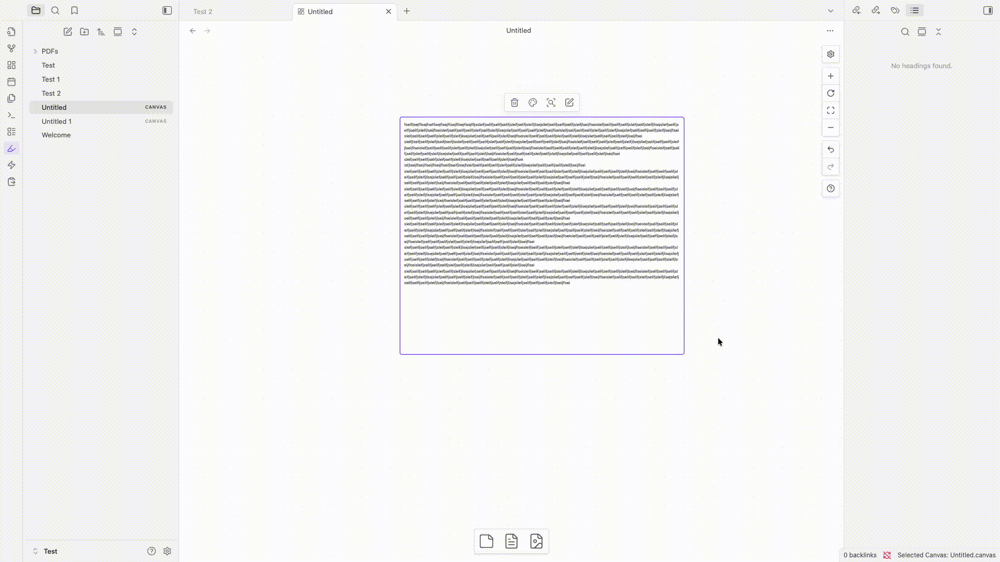

# Enhanced Canvas

> This Obsidian plugin enhances Obsidian Canvas with features I find essential.

## Features at a Glance

| Feature | What it does | How to use it |
| --- | --- | --- |
| [Canvas properties in notes](#canvas-properties-in-notes) | Writes a note's Canvas and its edges into the note's properties | Automatic |
| [Focus card from a link](#canvas-properties-in-notes) | Zooms to the note's card when you open a Canvas link from that note | Click the link |
| [Find in Canvas](#find-in-canvas) | Highlights the cards that contain a word or link to a note | **Cmd/Ctrl+F** in a Canvas |
| [Search Text in Images and PDFs](#search-text-in-images-and-pdfs) | Searches the text inside images (OCR) and PDFs, on your computer | Click the ribbon icon (on by default) |
| [Split Card by Headings](#split-card-by-headings) | Splits one card into a tree of cards, one per heading | Right-click a card → **Split by headings** |
| [Add Notes by Tag](#add-notes-by-tag) | Adds every note that matches a tag query | Right-click the Canvas → **Add notes by tag...** |
| [Send Note to Canvas](#send-note-to-canvas) | Sends the current note to a Canvas | **Send to Canvas** command |
| [Auto-Resize Card](#auto-resize-card) | Keeps a card's height fitted to its text | Double-click the card's bottom edge |
| [Default Card Size](#default-card-size) | Sets the size of new text and file cards | Settings → *Default card size* |
| [Hide Properties in Canvas Cards](#hide-properties-in-canvas-cards) | Hides the properties panel inside cards | Automatic |
| [Edge commands](#commands) | Adds edges from the links in notes, shortens edge paths, deletes edges | Command palette, on selected cards |

## Features

### Canvas Properties in Notes

1. **Add a note to a Canvas**: the note gets a `canvas` property with a link to that Canvas.

2. **Draw an edge between two notes**: the source note gets a link to the target note, in a property named after the Canvas (e.g. `Canvas 1` for `Canvas 1.canvas`).

3. **Click a Canvas link in a note**: the Canvas opens zoomed to that note's card.

**Good to know**

-   The plugin writes these properties into your notes. Enabling it adds them for every existing Canvas.
-   Renaming or deleting a Canvas or a note updates the properties.
-   To stop it, turn off *Enable Frontmatter Synchronization* in settings. Turning it off, or disabling the plugin, removes every property the plugin added.

### Find in Canvas

Search the cards of a Canvas. Matching cards are outlined, the rest are dimmed, matched text is highlighted, and the view zooms to fit the results.

**Start a search**

-   Press **Cmd+F** (Ctrl+F on Windows) in a Canvas, or run **"Find in canvas"** from the command palette, and type a word or a `[[link]]`.
-   Or select text in a card and right-click → **Find in canvas**. Selected text is searched as one phrase.
-   Click an empty spot on the Canvas to clear.

**Query syntax**

| Query                | Finds cards with                 |
| -------------------- | -------------------------------- |
| `canvas plugin`      | both words                       |
| `canvas OR plugin`   | either word (`OR` in uppercase)  |
| `"find text"`        | the exact phrase                 |
| `[[Note]]`           | a link to that note              |

You can combine them: `canvas plugin OR "find text"`.

**Good to know**

-   Searches text cards, note cards (including their content), group labels, and web links.
-   With *Search text in images and PDFs* on, image and PDF cards whose text matches are found too, and the matching text is boxed on images.
-   While editing a card, Cmd/Ctrl+F still searches that card.
-   Cmd/Ctrl+F is the core *Search current file* hotkey. Change it in Settings → Hotkeys, or bind *Find in canvas* separately.
-   Card colors and the `.canvas` file are never changed.
-   Change the highlight color with a CSS snippet: `body { --ec-find-color: <color>; }`

### Search Text in Images and PDFs

Search the text inside every image (OCR) and PDF in your vault. Everything is read on your computer; nothing is uploaded. On by default (setting *Search text in images and PDFs*).

**Search**

Run **"Search text in images and PDFs"** or click the ribbon icon. Same query syntax as [Find in Canvas](#find-in-canvas).

-   Results are sorted by matching lines, 50 at a time (**Show more** adds 50).
-   **All / Images / PDFs** filters by type; the button next to them switches to a compact list.
-   Image results box the matching text and list the notes that embed the image: choose one to open it there. PDF results open at the matching page.

**Elsewhere**

-   **Find in canvas** matches image and PDF cards too.
-   *Show image and PDF results in Search* adds them to core Search. Add `-file:.md -file:.canvas` to show only them.

**How images are read**

| Platform              | OCR                                                        |
| --------------------- | ---------------------------------------------------------- |
| macOS                 | macOS OCR (Vision, via `osascript`)                        |
| Windows 10/11         | [Built-in OCR](#built-in-ocr) (recommended) or Windows OCR |
| Linux                 | [Built-in OCR](#built-in-ocr)                              |
| iPhone, iPad, Android | None: they search the image text synced from a computer     |

PDFs need no OCR: every device, phones and tablets included, reads their embedded text itself.

**Windows: choose an engine**

Built-in OCR is the default: the first time images need reading, click **Download** in the notice (PDFs are indexed meanwhile). To use Windows OCR instead, choose it in settings → *OCR engine* (per vault and computer). After a switch, a notice offers **Read again with…** for images already read.

|                           | Built-in OCR (recommended)                          | Windows OCR                                    |
| ------------------------- | --------------------------------------------------- | ---------------------------------------------- |
| Download                  | About 60 MB, once                                   | None                                           |
| Languages                 | Many at once                                        | One (see [Limits](#limits))                    |
| Speed per image           | ~0.3 s with a graphics card, several s without      | ~0.3 s                                         |
| Company security software | Not affected (runs inside Obsidian)                 | May block it or close Obsidian (runs PowerShell) |

#### Built-in OCR

PaddleOCR (PP-OCRv6 small), running inside Obsidian on your graphics card (WebGPU) or CPU.

-   **Download**: about 60 MB from this project's GitHub release ([`ocr-assets-1`](https://github.com/RobertttBS/obsidian-enhanced-canvas/releases/tag/ocr-assets-1)), once per computer, only after you click **Download**: the text recognition models (31 MB) and the ONNX Runtime WebAssembly engine that runs them (29 MB, unmodified from `onnxruntime-web` 1.31.1). Each file is SHA-256 checked against a value fixed in the plugin. Your images are never uploaded.
-   **Storage**: Obsidian's IndexedDB on this computer, not your vault.
-   **Remove**: run **"Remove downloaded built-in OCR files"**.
-   **Licenses**: models Apache-2.0, libraries MIT. See [THIRD-PARTY-NOTICES.md](THIRD-PARTY-NOTICES.md).

**The index**

-   The first run takes a few minutes for a large vault; after that only new or changed files are read.
-   **"Rebuild image and PDF text index"** reads every file again.
-   Stored on each device in Obsidian's IndexedDB (database `enhanced-canvas-ocr-<vault id>`), outside your vault and not synced; no notes are added. Large PDFs make it big (tens of MB): add folders you don't need to *Settings → Files and links → Excluded files*, which are skipped.
-   **Delete it**: turn off *Search text in images and PDFs* on each device. That device's index, its downloaded built-in OCR files (about 60 MB, shared by the vaults on that device: another vault asks to download them again) and, on a computer, the image text it shared through sync are deleted. Uninstalling the plugin doesn't delete them, so turn the setting off first.
-   **Updating from an earlier version**: the index in the plugin's `ocr-index` folder is imported once, so nothing is read again. The folder stays for devices still on an earlier version; delete it once every device is updated.
-   **Phones and tablets**: turn on the same setting. PDFs are read on the device: the first run starts a few seconds after the vault opens, takes longer than on a computer, and continues where it stopped if the app is closed or put in the background. Image text arrives from your computers through sync (below).
-   **Several computers on one vault**: each reads the vault itself. Images read on one are searchable on the others through sync (below).

**Image text on your other devices**

Each computer also writes the text of the images it read to files in the vault's config folder (`.obsidian`, top level), which Obsidian Sync, iCloud and other sync tools carry to your phones and other computers:

-   `enhanced-canvas-ocr.<device id>.json` (also `.<device id>.1.json`… when large) and `enhanced-canvas-ocr.<device id>.new.json` (recent changes). Each computer writes only its own files. They hold image text only, never PDF text.
-   A phone or tablet whose config folder isn't `.obsidian` (e.g. `.obsidian-mobile`) doesn't see them.
-   An image renamed or deleted on a phone shows up correctly once a computer has caught up.
-   **A computer you no longer use**: run **"Remove image text from other devices…"** and tick it.
-   These files stay when you uninstall the plugin: delete `enhanced-canvas-ocr.*.json` in the config folder by hand.

**Password-protected PDFs**

Click **Unlock…** in the notice after indexing, or run **"Unlock password-protected PDFs for text search"**, and enter each password once (it's tried on the other PDFs too). The password isn't saved. The text stays in this device's index until the PDF changes, unencrypted. Unlock it on each device.

#### If reading images is paused

PDFs keep being indexed.

-   **Windows OCR can't run** (no OCR language, or PowerShell blocked): the notice says why. Click **Use built-in OCR**.
-   **Obsidian was closed while reading images** (some company security software does this when a plugin starts PowerShell or `osascript`): reading images pauses on that computer, for every vault. The notice offers **Use built-in OCR** (Windows) or **Keep using Windows/macOS OCR**. If it happens again, the system OCR stays off until you click **Try … OCR again** in settings.

To detect this, the plugin keeps two small files outside your vault (macOS and Windows): `enhanced-canvas-ocr-running-<vault id>` in the temp folder while OCR runs, and `obsidian-enhanced-canvas/ocr-killed.json` in `%LOCALAPPDATA%` or `~/Library/Application Support` after such a close (delete it to reset).

#### Limits

-   PDFs: only embedded text is searched; scanned PDFs without a text layer aren't.
-   A `"phrase"` can't span lines.
-   Windows OCR reads one language: the first Chinese, Japanese or Korean language in *Settings → Time & language → Language* with OCR installed (these also read English), else the first listed language with OCR. If it can't read images, add the language's *Optical character recognition* feature.
-   Windows OCR reads HEIC and WebP only with the matching Microsoft Store codec.

### Split Card by Headings

Splits one card into a tree of cards, one per heading. Right-click a note card or a text card and choose **Split by headings**.

-   *Choose heading level on split*: asks which level to split down to (e.g. H2). Deeper headings stay in their parent card.
-   *Auto-resize leaf cards on split*: fits each new card's height to its text. *Max auto-resize height* caps it; longer content scrolls.

### Add Notes by Tag

Right-click an empty spot on the Canvas and choose **"Add notes by tag..."** to add every note matching a tag query at once. Tags autocomplete as you type.

-   Space means AND: `#project #active`
-   `OR` means OR: `#book OR #article`
-   `-` excludes: `#project -#archived`

### Send Note to Canvas

Run **"Send to Canvas"** in a note and pick a Canvas: the note is added as a card. The Canvas is remembered, so **"Send to Selected Canvas"** adds other notes to it without picking again. **"Clear selected Canvas file"** forgets it.

### Auto-Resize Card

Double-click a card's bottom edge: its height then follows its text as you edit or change the width. Dragging the bottom edge turns it off.

### Default Card Size

Set the width and height of new text cards and new file cards in settings → *Default card size* (50–5000 px).

### Hide Properties in Canvas Cards

Hides the properties panel inside Canvas cards and embedded notes. Turn off *Hide properties in Canvas cards* to show it.

## Commands

Edge commands work on the selected cards:

-   **Add edges according to the links in notes**: draws an edge wherever one note links to another, then shortens the paths.
-   **Adjust edges with shortest path**: re-routes edges along the shortest path.
-   **Delete edges between selected cards**
-   **Remove the property of all cards in current Canvas**: removes this plugin's properties from every note in the current Canvas.
-   **Show feature guide**: opens the in-app guide to every feature.

Other commands are listed under their feature: [Send Note to Canvas](#send-note-to-canvas), [Find in Canvas](#find-in-canvas), [Search Text in Images and PDFs](#search-text-in-images-and-pdfs).

### Demo

**Add edges according to the links in notes**, on all card types (text, groups, images, nested Canvases):

## Installation Steps

Search for "Enhanced Canvas" in the community plugins and install it. Once enabled, it adds the Canvas properties to the notes in your existing .canvas files.

## Contributing

All contributions are welcome!

## Say Thank You

If you are enjoying Enhanced Canvas, then please support my work and enthusiasm by buying me a coffee on https://buymeacoffee.com/robertttbs.
