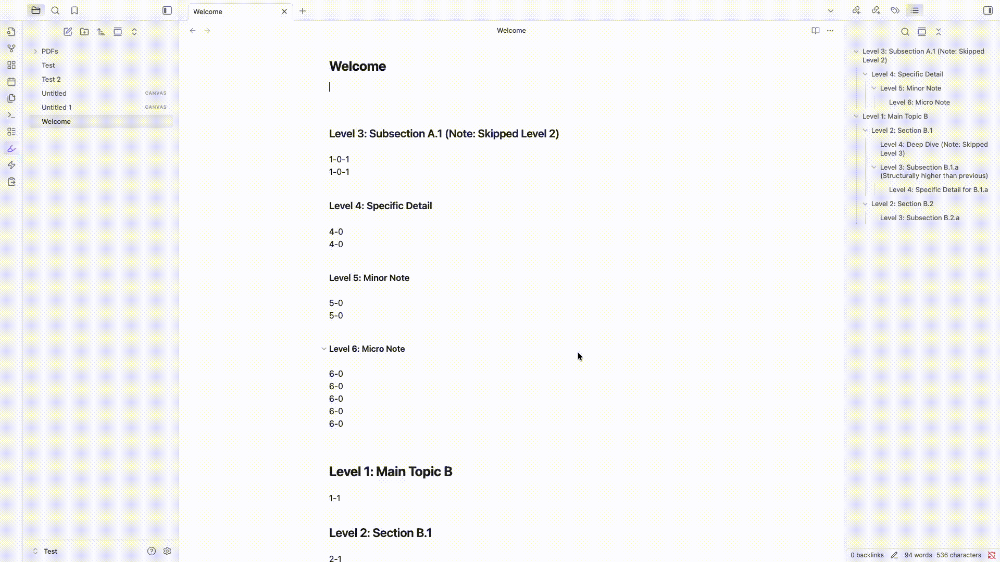
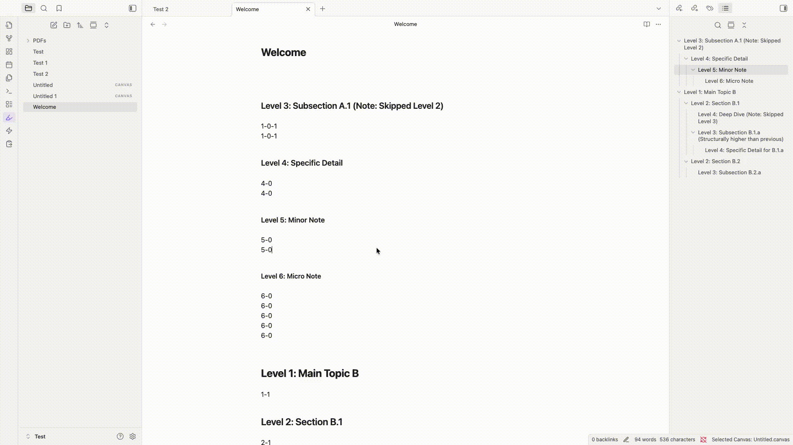
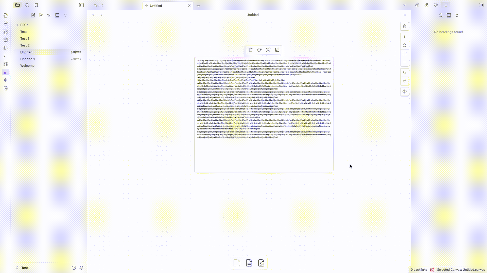
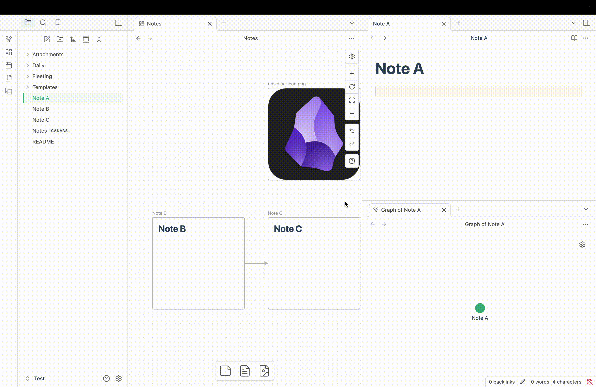
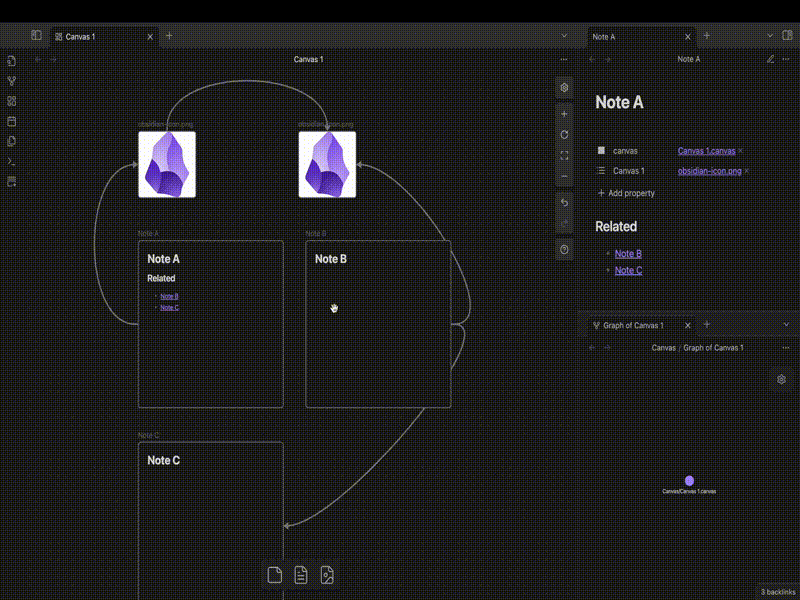

# Enhanced Canvas

> This Obsidian plugin enhances Obsidian Canvas with features I find essential.

## ✨New Feature✨

### Find in Canvas

Press **Cmd+F** (Ctrl+F on Windows) in a Canvas, or run **"Find in canvas"** from the command palette, and type a word or a `[[link]]`. Every card that contains the word, or links to that note, is outlined and the rest are dimmed; matched text is highlighted and the view zooms to fit the results. Select text in a card and right-click → **Find in canvas** to search for it directly. Click an empty spot on the Canvas to clear.

-   Change the hotkey in Settings → Hotkeys.
-   Searches text cards, note cards (including their content), group labels, and web links.
-   Node colors and the `.canvas` file are never changed.
-   Change the highlight color with a CSS snippet: `body { --ec-find-color: <color>; }`

### Split Node by Headings

**Split Node by Headings** instantly deconstructs a single node into a hierarchical tree based on its headings. You can try this by right-clicking on a file (text) node and selecting "Split by headings" in Canvas.

-   **Choose the heading level**: turn on *Choose heading level on split* in settings, and the plugin asks which level to split down to (e.g. H2). Deeper headings stay inside their parent card.
-   **Cards fit their content**: with *Auto-resize leaf nodes on split* on, each new card's height fits its text and the tree is re-laid out. *Max auto-resize height* caps how tall a card can grow; longer content scrolls.

### Add Notes by Tag

Right-click an empty spot on the Canvas and choose **"Add notes by tag..."** to add every note matching a tag query at once. Tags autocomplete as you type.

-   Space means AND: `#project #active`
-   `OR` means OR: `#book OR #article`
-   `-` excludes: `#project -#archived`

### Send Note to Canvas

With the **"Send to Canvas"** command, you can push your current markdown note directly to a specific Canvas. It automatically appends a "canvas" property to your note, allowing you to navigate back to the board instantly in the future.

Once you have sent a note, that Canvas becomes the "Selected." You can then use the **"Send to Selected Canvas"** command on other notes to instantly add them to the same board—bypassing the file selection step entirely.

### Auto-Resize Node

With this update, double-clicking the bottom edge engages **"Auto-Resize."** Now, when you drag the right edge to adjust the width or update the text, the height dynamically adjusts to fit your text. No need for repeated double-clicking!

Dragging the bottom edge to manually adjust the height disables the node's auto-resize feature.

## Main Feature

Based on this demo:

1. **Node addition**: When a note is added to the canvas, the plugin generates a 'canvas' property with a link to its corresponding canvas file.

2. **Edge addition**: Creating an edge in the Canvas generates a link to the target note within a property named after the canvas file (e.g., 'Canvas 1'), where the property name is derived from the canvas file name without its '.canvas' extension.

3. **Node Focusing**: Upon clicking a link to a .canvas file from a note, the system automatically focuses and zooms to the associated node in the canvas.

**Note 1**: All Canvas-related properties will be added when this plugin is enabled, and all properties added by this plugin will be removed upon disabling it.

**Note 2**: If you delete or rename a .canvas or Markdown file, all associated properties will also be updated.

**Note 3**: To stop the plugin from writing these properties, turn off *Enable Frontmatter Synchronization* in settings. Turning it off removes every property the plugin added.

### Hide Properties in Canvas Nodes

The properties panel inside Canvas nodes and embedded notes is hidden. To show it again, turn off *Enable Custom Visuals & CSS* in settings.

## Commands

-   **Adjust edges with shortest path**

    -   Adjusts edges between selected nodes using shortest path

-   **Delete edges between selected nodes**

    -   Removes all edges between selected nodes

-   **Add edges according the links in notes**

    -   Automatically creates edges between selected nodes based on links within notes

-   **Remove the property of all nodes in current Canvas**
    -   Removes properties from all nodes in the current Canvas

-   **Send to Canvas** / **Send to Selected Canvas** / **Clear selected Canvas file**
    -   See [Send Note to Canvas](#send-note-to-canvas)

-   **Find in canvas (selected text or link)** / **Clear find highlights**
    -   See [Find in Canvas](#find-in-canvas)

-   **Show feature guide**
    -   Opens an in-app guide to every feature, with where to find it and which settings control it

### Demo

-   **Add edges according the links in notes**

-   Automatically establishes connections based on existing markdown links in notes

-   It integrates **Adjust edges with shortest path**

-   Optimizes edge paths in Canvas for minimal distance

-   Supports all node types (text nodes, group nodes, images, nested Canvases, etc.)

## Installation Steps

Search for "Enhanced Canvas" in the community plugins and install it. Once enabled, it automatically adds all properties to existing .canvas files.

## Contributing

All contributions are welcome!

## Say Thank You

If you are enjoying Enhanced Canvas, then please support my work and enthusiasm by buying me a coffee on https://buymeacoffee.com/robertttbs.
