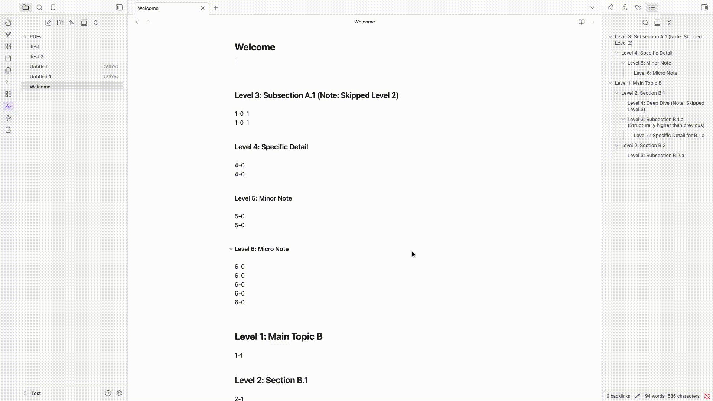
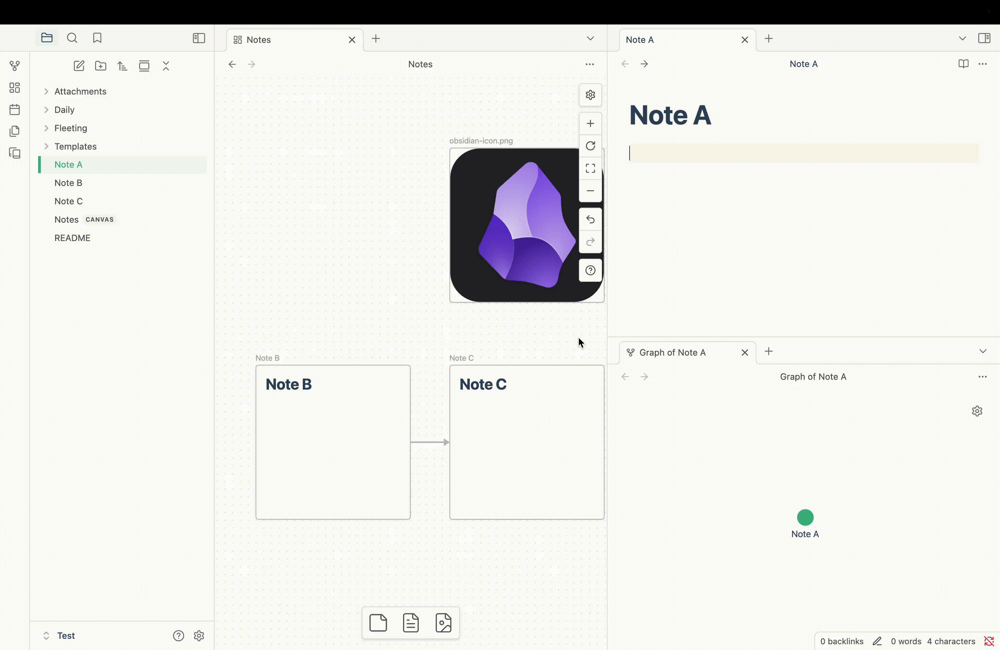

# Enhanced Canvas

> This Obsidian plugin enhances Obsidian Canvas with features I find essential.

## Features at a Glance

| Feature | What it does | How to use it |
| --- | --- | --- |
| [Find in Canvas](#find-in-canvas) | Highlights the cards that contain a word or link to a note | **Cmd/Ctrl+F** in a Canvas |
| [Search Text in Images and PDFs](#search-text-in-images-and-pdfs) | Searches the text inside images (OCR) and PDFs, on-device | Turn on in settings, then click the ribbon icon |
| [Split Node by Headings](#split-node-by-headings) | Splits one card into a tree of cards, one per heading | Right-click a card → **Split by headings** |
| [Add Notes by Tag](#add-notes-by-tag) | Adds every note that matches a tag query | Right-click the Canvas → **Add notes by tag...** |
| [Send Note to Canvas](#send-note-to-canvas) | Sends the current note to a Canvas | **Send to Canvas** command |
| [Auto-Resize Node](#auto-resize-node) | Keeps a card's height fitted to its text | Double-click the card's bottom edge |
| [Canvas properties in notes](#main-feature) | Writes a note's Canvas and its edges into the note's properties | Automatic |
| [Focus node from a link](#main-feature) | Zooms to the note's card when you open a Canvas link from that note | Click the link |
| [Hide Properties in Canvas Nodes](#hide-properties-in-canvas-nodes) | Hides the properties panel inside cards | Automatic |
| [Edge commands](#commands) | Adds edges from the links in notes, shortens edge paths, deletes edges | Command palette, on selected cards |

## ✨New Feature✨

### Find in Canvas

Search the cards of a Canvas. Matching cards are outlined, the rest are dimmed, matched text is highlighted, and the view zooms to fit the results.

**Start a search**

-   Press **Cmd+F** (Ctrl+F on Windows) in a Canvas, or run **"Find in canvas"** from the command palette, and type a word or a `[[link]]`.
-   Or select text in a card and right-click → **Find in canvas**. Selected text is searched as one phrase.
-   Click an empty spot on the Canvas to clear.

**Query syntax**

| Query                | Finds cards with                 |
| -------------------- | -------------------------------- |
| `canvas plugin`      | both words                       |
| `canvas OR plugin`   | either word (`OR` in uppercase)  |
| `"find text"`        | the exact phrase                 |
| `[[Note]]`           | a link to that note              |

You can combine them: `canvas plugin OR "find text"`.

**Good to know**

-   Searches text cards, note cards (including their content), group labels, and web links.
-   With *Search text in images and PDFs* on, image and PDF cards whose text matches are found too, and the matching text is boxed on images.
-   While editing a card, Cmd/Ctrl+F still searches that card.
-   Cmd/Ctrl+F is the core *Search current file* hotkey. Change it in Settings → Hotkeys, or bind *Find in canvas* separately.
-   Node colors and the `.canvas` file are never changed.
-   Change the highlight color with a CSS snippet: `body { --ec-find-color: <color>; }`

### Search Text in Images and PDFs

Search the text inside every image and PDF in your vault. Everything runs on your device: nothing is downloaded and nothing leaves your computer. Off by default.

**Set up**

Turn on *Search text in images and PDFs* in settings. The plugin then reads the text in your images with the system's built-in OCR, and indexes the embedded text of your PDFs.

**Search**

Run **"Search text in images and PDFs"** or click the ribbon icon. The query syntax is the same as [Find in Canvas](#find-in-canvas) (words, `OR`, `"phrase"`).

-   Results are numbered and sorted by the number of matching lines. The total count is shown on top.
-   The first 50 results are listed. **Show more** at the end of the list adds 50 more.
-   The **All / Images / PDFs** buttons show only one file type, each with its number of matches.
-   The button on their right switches to a compact list without thumbnails: the file name and its first matching line.
-   Image results show the image with the matching text boxed, and the notes that embed it. Choose a note to open it at the image (a Canvas zooms to the image card).
-   PDF results show the page number of each matching line. Choose one to open the PDF at that page.

**Other places that use the index**

-   **Find in canvas** also matches image and PDF cards by their text.
-   Turn on *Show image and PDF results in Search* to see matching images and PDFs in core Search (search in all files) next to your notes, with a thumbnail under each image's name. The query syntax is the same as for notes. Add `-file:.md -file:.canvas` to show only images and PDFs.

**The index**

-   The first run takes a few minutes for a large vault: about 0.3 s per image, about 11 s for a 2,700-page PDF. After that, only new or changed files are read.
-   Run **"Rebuild image and PDF text index"** to read every file again, for example after a file couldn't be read.
-   Files in *Settings → Files and links → Excluded files* are skipped.
-   The index is stored in the `ocr-index` folder inside the plugin folder. No notes are added to your vault.
-   Large PDFs make the index big (tens of MB for a few hundred MB of PDFs). Add folders you don't need searched to *Excluded files*.

**Platforms**

| Platform                     | What it does                                                                                 |
| ---------------------------- | -------------------------------------------------------------------------------------------- |
| macOS                        | Reads images with the Vision framework, called through the system's `osascript`              |
| Windows 10/11                | Reads images with `Windows.Media.Ocr`, called through Windows PowerShell (`powershell.exe`)  |
| Linux, iPhone, iPad, Android | Search only: uses an index built on a Mac or Windows PC and synced to the device             |

-   **Search-only devices**: turn on the same setting. Results show what the computer last read. Your sync tool must sync the `ocr-index` folder in the plugin folder.
-   **Build the index on one computer only.** Two computers with this setting on overwrite each other's index.

**Limits**

-   PDFs: only embedded text is searched. Scanned PDFs without a text layer and password-protected PDFs are not searchable.
-   A `"phrase"` can't span lines, so a PDF sentence that breaks at the end of a line isn't found as a phrase.
-   Windows OCR reads one language: the first Chinese, Japanese or Korean language in *Settings → Time & language → Language* that has an OCR language pack installed (these also read English). Otherwise it uses the first listed language that has one.
-   Most Windows languages install an OCR pack with the language. If images can't be read, add the language's optical character recognition feature.
-   Windows can't read HEIC or WebP images unless the matching codec from the Microsoft Store is installed.

### Split Node by Headings

**Split Node by Headings** instantly deconstructs a single node into a hierarchical tree based on its headings. You can try this by right-clicking on a file (text) node and selecting "Split by headings" in Canvas.

-   **Choose the heading level**: turn on *Choose heading level on split* in settings, and the plugin asks which level to split down to (e.g. H2). Deeper headings stay inside their parent card.
-   **Cards fit their content**: with *Auto-resize leaf nodes on split* on, each new card's height fits its text and the tree is re-laid out. *Max auto-resize height* caps how tall a card can grow; longer content scrolls.

### Add Notes by Tag

Right-click an empty spot on the Canvas and choose **"Add notes by tag..."** to add every note matching a tag query at once. Tags autocomplete as you type.

-   Space means AND: `#project #active`
-   `OR` means OR: `#book OR #article`
-   `-` excludes: `#project -#archived`

### Send Note to Canvas

With the **"Send to Canvas"** command, you can push your current markdown note directly to a specific Canvas. It automatically appends a "canvas" property to your note, allowing you to navigate back to the board instantly in the future.

Once you have sent a note, that Canvas becomes the "Selected." You can then use the **"Send to Selected Canvas"** command on other notes to instantly add them to the same board—bypassing the file selection step entirely.

### Auto-Resize Node

With this update, double-clicking the bottom edge engages **"Auto-Resize."** Now, when you drag the right edge to adjust the width or update the text, the height dynamically adjusts to fit your text. No need for repeated double-clicking!

Dragging the bottom edge to manually adjust the height disables the node's auto-resize feature.

## Main Feature

Based on this demo:

1. **Node addition**: When a note is added to the canvas, the plugin generates a 'canvas' property with a link to its corresponding canvas file.

2. **Edge addition**: Creating an edge in the Canvas generates a link to the target note within a property named after the canvas file (e.g., 'Canvas 1'), where the property name is derived from the canvas file name without its '.canvas' extension.

3. **Node Focusing**: Upon clicking a link to a .canvas file from a note, the system automatically focuses and zooms to the associated node in the canvas.

**Note 1**: All Canvas-related properties will be added when this plugin is enabled, and all properties added by this plugin will be removed upon disabling it.

**Note 2**: If you delete or rename a .canvas or Markdown file, all associated properties will also be updated.

**Note 3**: To stop the plugin from writing these properties, turn off *Enable Frontmatter Synchronization* in settings. Turning it off removes every property the plugin added.

### Hide Properties in Canvas Nodes

The properties panel inside Canvas nodes and embedded notes is hidden. To show it again, turn off *Enable Custom Visuals & CSS* in settings.

## Commands

-   **Adjust edges with shortest path**

    -   Adjusts edges between selected nodes using shortest path

-   **Delete edges between selected nodes**

    -   Removes all edges between selected nodes

-   **Add edges according the links in notes**

    -   Automatically creates edges between selected nodes based on links within notes

-   **Remove the property of all nodes in current Canvas**
    -   Removes properties from all nodes in the current Canvas

-   **Send to Canvas** / **Send to Selected Canvas** / **Clear selected Canvas file**
    -   See [Send Note to Canvas](#send-note-to-canvas)

-   **Find in canvas (selected text or link)** / **Clear find highlights**
    -   See [Find in Canvas](#find-in-canvas)

-   **Search text in images and PDFs** (when enabled)
    -   See [Search Text in Images and PDFs](#search-text-in-images-and-pdfs)

-   **Show feature guide**
    -   Opens an in-app guide to every feature, with where to find it and which settings control it

### Demo

-   **Add edges according the links in notes**

-   Automatically establishes connections based on existing markdown links in notes

-   It integrates **Adjust edges with shortest path**

-   Optimizes edge paths in Canvas for minimal distance

-   Supports all node types (text nodes, group nodes, images, nested Canvases, etc.)

## Installation Steps

Search for "Enhanced Canvas" in the community plugins and install it. Once enabled, it automatically adds all properties to existing .canvas files.

## Contributing

All contributions are welcome!

## Say Thank You

If you are enjoying Enhanced Canvas, then please support my work and enthusiasm by buying me a coffee on https://buymeacoffee.com/robertttbs.
